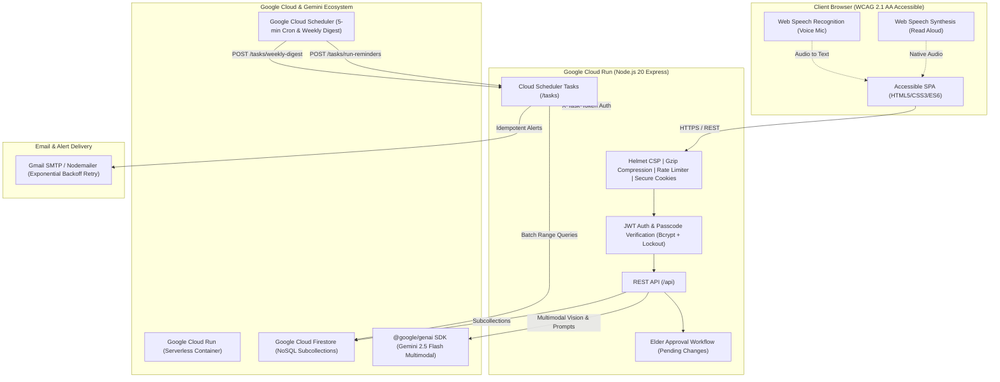

# CareCircle ⭕
> **Collaborative Elderly Care & Medication Management Platform**  
> *Smarter, accessible, proactive, and dignified — keeping the senior at the center of every care decision.*

[](https://github.com/)
[](https://github.com/)
[](https://www.w3.org/WAI/WCAG21/quickref/)
[](https://cloud.google.com/run)
[](https://ai.google.dev/)

---

## 📖 Problem Summary & Vision

Elderly medication management is fraught with risk:
- **Disempowerment & Anxiety**: Seniors frequently feel bypassed when family or caregivers unilaterally alter their routines.
- **Cognitive & Physical Barriers**: Vision decline, tremors, and arthritis make tiny fonts and complex dropdowns inaccessible.
- **Polypharmacy Conflicts**: Seniors frequently take 5+ prescriptions simultaneously, creating dangerous drug-drug interactions or duplicate therapies.
- **Communication Gaps**: Missed doses often go unnoticed until clinical complications arise, leading to preventable hospitalizations.

**CareCircle** transforms elderly care into a collaborative, transparent circle:
1. **Elder in the Driver's Seat**: With *Elder Approval Mode*, no caregiver or family member can change medications or appointments without the senior's explicit review and approval.
2. **Accessible by Design (WCAG 2.1 AA Compliant)**: 20px+ base typography, one primary action per screen, 64px+ touch buttons, high-contrast mode, and client-side Web Speech audio readouts.
3. **Proactive Reminders & Escalations**: Automated 5-minute scheduler checks for upcoming doses, marks missed doses, alerts caregivers after 60 minutes, warns on low stock, and delivers weekly adherence digests.
4. **Google Gemini Multimodal AI**: Vision prescription scanner, conversational voice/text assistant with strict confirmation safeguards, drug interaction safety checks, and personalized adherence tips.

---

## ✨ Features Overview

| Feature Category | Description |
| :--- | :--- |
| **Elder-Centric Approval Workflow** | When enabled, edits to meds or appointments made by caretakers trigger a `202 Accepted` pending status. Changes only apply when the elder clicks "Approve" on their dashboard. |
| **Senior-First Accessibility** | Scalable typography (A / A+ / A++), persistent High Contrast mode, simplified "Elder Mode" view, keyboard navigation with visible focus rings, ARIA live regions, and screen-reader skip links. |
| **Voice & Speech Synthesis** | Built-in Web Speech API audio readout (*"Read Schedule Aloud"*) and speech-to-text microphone assistant for hands-free interactions. |
| **Multimodal Vision Prescription Scanner** | Uploads prescription labels (JPEG/PNG/WebP, validated by MIME + magic bytes) to Gemini 2.5 Flash. Returns an editable draft review table before saving. |
| **Conversational AI Assistant** | Converts natural-language phrases (*"I took my morning blood pressure pill"*, *"Schedule Dr. Gupta on Friday 10am"*) into validated actions. **Never writes directly to DB without user confirmation.** |
| **Drug Interaction Safety Check** | Analyzes the profile's active medications using Gemini to flag interactions, duplicate therapies, and timing conflicts with severity ratings and clinical disclaimers. |
| **Proactive Reminder Engine** | Cloud Scheduler endpoint (`POST /tasks/run-reminders`) runs every 5 minutes: sends upcoming dose reminders, marks missed doses at 30 min, escalates to family at 60 min, alerts 24h & 2h before appointments, and triggers daily refill warnings. |
| **Deterministic Idempotency** | Every notification is keyed deterministically (`type_entityId_date_memberId`). Prevents duplicate emails even under concurrent scheduler executions. |
| **Multi-Member Circle & Secure Passcodes** | Elders invite caretakers with single-use 8-character hashed passcodes. Granular permissions matrix (`canEditMeds`, `canEditAppointments`, `receiveAlerts`) and 5-attempt brute-force lockout. |
| **Activity Audit Trail** | Tamper-evident activity logs capturing who proposed, approved, created, or took every medication or appointment. |

---

## 🏛️ System Architecture



---

## ☁️ Google Services Used & Why

1. **Google Cloud Run**
   - **Why**: Fully managed serverless container platform with HTTPS, zero server maintenance, rapid autoscaling, non-root container isolation, and sub-second scaling.
2. **Google Cloud Firestore (`@google-cloud/firestore`)**
   - **Why**: Native hierarchical subcollection model (`profiles/{id}/medications`, `doseLogs`, `appointments`, `notifications`, `auditLogs`). Provides sub-millisecond lookups and composite index filtering.
3. **Google Gemini API (`@google/genai` SDK, `gemini-2.5-flash`)**
   - **Why**: State-of-the-art multimodal vision for digitizing messy handwritten prescriptions, structured JSON output with Zod schema validation, and conversational reasoning for intent parsing.
4. **Google Cloud Scheduler**
   - **Why**: Enterprise cron triggering proactive reminders every 5 minutes and weekly adherence digests via authenticated HTTP headers (`X-Task-Token`).
5. **Web Speech API**
   - **Why**: Zero-latency, browser-native text-to-speech and speech-to-text, providing accessible voice interaction without transmitting biometric voice data over the internet.

---

## 🔐 Security & Hardening

- **Content Security Policy (CSP)**: Locked down via `helmet` restricting script, style, frame, and connect origins.
- **XSS Sanitization**: All user-generated text (med names, doctor names, notes, chat transcripts, rejection reasons) is passed through `ui.escapeHtml()` before rendering.
- **Passcode Hashing & Constant-Time Verification**: Passcodes are hashed with `bcryptjs`. Cloud Scheduler task tokens are validated using `crypto.timingSafeEqual`.
- **Brute-Force Lockout**: 5 consecutive failed login attempts trigger an automatic 15-minute account lockout.
- **Generic Auth Errors**: Authentication failure messages do not leak account existence or whether email vs passcode was incorrect.
- **Input Validation**: 100% of API endpoints validate request payloads with strict `zod` schemas. Express body parser enforces a strict 1MB size limit.
- **Secure Sessions**: Signed JWTs stored in `httpOnly`, `sameSite: 'strict'`, `secure: true` cookies.
- **No Secrets in Code**: Environment credentials (`JWT_SECRET`, `TASK_TOKEN`, `SMTP_PASS`, `GEMINI_API_KEY`) loaded strictly via `process.env`.

---

## 🎨 Design System & Senior Accessibility (WCAG 2.1 AA Compliant)

CareCircle features a custom, senior-centered design system built without heavy frameworks or build steps. It combines a calming, trustworthy visual aesthetic with rigorous accessibility engineering.

### 1. Color Palette & WCAG 2.1 AA Contrast Ratios

All foreground and background color combinations have been mathematically validated to meet or exceed WCAG 2.1 AA contrast requirements ($\ge 4.5:1$ for normal text, $\ge 7.0:1$ for high-contrast mode):

| UI Token | Hex Code | Background | Computed Contrast Ratio | WCAG Compliance |
| :--- | :--- | :--- | :--- | :--- |
| **Page Background** | `--bg: #FFF8F1` | — | Soft, warm cream | Base Canvas |
| **Surface Card** | `--surface: #FFFFFF` | `#FFF8F1` | 1.05:1 | Layered Soft Shadow |
| **Primary Ink** | `--ink: #1F2A37` | `#FFFFFF` | **14.54:1** | Pass (AAA) |
| **Secondary Ink** | `--ink-soft: #4B5563` | `#FFFFFF` | **7.56:1** | Pass (AAA) |
| **Primary Brand** | `--primary: #1F7A5C` | `#FFFFFF` | **5.25:1** | Pass (AA) |
| **White on Primary**| `#FFFFFF` | `#1F7A5C` | **5.25:1** | Pass (AA) |
| **CTA Yellow** | `--cta: #FFC94A` | Dark Ink `#1F2A37` | **9.49:1** | Pass (AAA) |
| **Status Taken** | `--status-taken: #1F7A5C` | `#E3F4EC` | **4.61:1** | Pass (AA) |
| **Status Pending** | `--status-pending: #8A5300` | `#FEF3C7` | **5.68:1** | Pass (AA) |
| **Status Missed** | `--status-missed: #B3261E` | `#FEE2E2` | **5.35:1** | Pass (AA) |
| **Status Snoozed** | `--status-snoozed: #1F6FA6` | `#E0F2FE` | **4.71:1** | Pass (AA) |
| **High-Contrast Dark** | `#000000` | `#FFFFFF` | **21.00:1** | Pass (AAA Max) |
| **High-Contrast Yellow**| `#FFFF00` | `#000000` | **19.56:1** | Pass (AAA Max) |

### 2. Dual Indicators (Zero Non-Color Reliance)
In accordance with WCAG Guideline 1.4.1, color is never used as the sole visual means of conveying information. Every status chip pairs a dedicated inline SVG line icon with explicit text labels:
- **Taken**: `<svg><use href="#icon-check"/></svg> TAKEN`
- **Due**: `<svg><use href="#icon-clock"/></svg> DUE`
- **Missed**: `<svg><use href="#icon-alert"/></svg> MISSED`
- **Snoozed**: `<svg><use href="#icon-snooze"/></svg> SNOOZED`

### 3. Accessible Responsive Shell
- **Desktop ($\ge 1024\text{px}$)**: Ergonomic left sidebar containing primary navigation links (Today, Medicines, Calendar, Care Circle, Health, Activity Log, Notifications) alongside a centered, constrained reading column.
- **Mobile ($\le 1023\text{px}$)**: Fixed bottom navigation bar featuring the 4 core daily tabs (*Today*, *Medicines*, *Calendar*, *Circle*) plus an accessible native slide-up *"More"* sheet containing Health trends, Reminders, and Circle activity.
- **Strict Content Security Policy (CSP)**: Completely eliminates `'unsafe-inline'` from both `scriptSrc` and `styleSrc`. Dynamic layouts leverage semantic CSS classes and SVG presentation attributes.

### 4. Senior-First Assistive Features
- **Typography Scaling**: Base 20px typography, instantly scalable via senior toolbar buttons (**A** 20px, **A+** 24px, **A++** 28px). Headings set in Fraunces serif; body in Nunito sans.
- **Giant Touch Targets**: Minimum $48\times 48\text{px}$ touch targets across all interactive elements, expanding to $64\text{px}$ for the hero *"I took it"* button.
- **Simplified Elder Mode**: Toggles off secondary navigation and administrative tabs, showing only today's due medications with large one-tap buttons.
- **Voice Readout & Recognition**: Web Speech API audio synthesis reads out the day's routine aloud; browser-native speech recognition provides voice dictation for elderly users with tremors.
- **WAI-ARIA Landmarks & Keyboard Navigation**: Full keyboard navigation with skip-to-content link, arrow-key tab navigation, visible focus rings, and `aria-live="polite"` regions for real-time status updates.


---

## 🛠️ Setup & Installation

### Prerequisites
- Node.js >= 20.0.0
- npm >= 9.0.0
- Google Cloud SDK (`gcloud`) *(optional for Cloud deployment)*

### 1. Clone & Install
```bash
git clone https://github.com/your-repo/carecircle.git
cd carecircle
npm install
```

### 2. Environment Setup
Copy the sample environment file:
```bash
cp .env.example .env
```

Configure your environment variables:
```env
PORT=8080
NODE_ENV=development
DATA_STORE=memory                # Use 'memory' for local dev/testing, 'firestore' for production
JWT_SECRET=super-secret-jwt-key-min-32-chars
COOKIE_SECRET=super-secret-cookie-key-min-32-chars
TASK_TOKEN=super-secure-cloud-scheduler-task-token

# Google Cloud Firestore (when DATA_STORE=firestore)
FIRESTORE_PROJECT_ID=your-gcp-project-id

# Google Gemini API
GEMINI_API_KEY=your-gemini-api-key
GEMINI_MODEL=gemini-2.5-flash

# Email / Nodemailer SMTP
SMTP_USER=your-email@gmail.com
SMTP_PASS=your-16-char-app-password
MAIL_FROM=CareCircle Alerts <your-email@gmail.com>
```

### 3. Run Locally
```bash
# Start server
npm start
```
Open [http://localhost:8080](http://localhost:8080) in your browser.

---

## 🧪 Running Tests & Coverage

CareCircle features a comprehensive test suite across unit, integration, and end-to-end user flows.

```bash
# Run all tests
npm test

# Run tests with full coverage report
npm run test:coverage

# Run ESLint linter
npm run lint

# Automatically fix linting issues
npm run lint:fix
```

### Coverage Highlights
- **19 Test Suites, 71 Tests Passing**
- **Controllers**: ~81%
- **Middlewares**: ~80%
- **Services**: ~86%
- **Repositories (Memory)**: ~99%
- **Routes**: ~99%
- **Utilities**: ~95%
- **AI Engine**: 100%

---

## 🚀 Deployment to Google Cloud Run & Scheduler

### 1. Deploy Container to Cloud Run
```bash
# Set Google Cloud Project
gcloud config set project carecircle-471887193815

# Build and deploy directly to Cloud Run
gcloud run deploy carecircle \
  --source . \
  --region asia-south1 \
  --platform managed \
  --allow-unauthenticated \
  --set-env-vars DATA_STORE=firestore,FIRESTORE_PROJECT_ID=carecircle-471887193815,NODE_ENV=production,TASK_TOKEN=carecircle-task-secret-token-2026,GEMINI_MODEL=gemini-2.5-flash \
  --set-secrets GEMINI_API_KEY=GEMINI_API_KEY:latest,JWT_SECRET=JWT_SECRET:latest,COOKIE_SECRET=COOKIE_SECRET:latest,SMTP_USER=SMTP_USER:latest,SMTP_PASS=SMTP_PASS:latest
```

### 2. Configure Cloud Scheduler for 5-Minute Reminders
```bash
gcloud scheduler jobs create http carecircle-run-reminders \
  --schedule="*/5 * * * *" \
  --uri="https://carecircle-471887193815.asia-south1.run.app/tasks/run-reminders" \
  --http-method=POST \
  --headers="X-Task-Token=carecircle-task-secret-token-2026" \
  --location=asia-south1 \
  --description="Evaluates medication schedules, upcoming doses, missed doses, and escalations every 5 minutes"
```

### 3. Configure Cloud Scheduler for Weekly Family Digest
```bash
gcloud scheduler jobs create http carecircle-weekly-digest \
  --schedule="0 9 * * 0" \
  --uri="https://carecircle-471887193815.asia-south1.run.app/tasks/weekly-digest" \
  --http-method=POST \
  --headers="X-Task-Token=carecircle-task-secret-token-2026" \
  --location=asia-south1 \
  --description="Dispatches weekly adherence digest to family and caretakers every Sunday morning"
```

---

## 📱 Evaluator Demo Flow

Follow this step-by-step walkthrough to evaluate CareCircle:

1. **Elder Registration**:
   - Navigate to the web app (`https://carecircle-471887193815.asia-south1.run.app`).
   - Register a new profile (e.g. *Grandpa Jack*, email, 8-character passcode).
   - Note the assigned **CareCircle ID**.
2. **Senior Accessibility Experience**:
   - Click **"Senior / High Contrast Mode"** at the top right to verify high contrast styling.
   - Click **A / A+ / A++** to test instant typography scaling.
   - Click **"👴 Elder Mode: Simplified"** to observe the distraction-free schedule layout.
   - Click **"🔊 Read Schedule Aloud"** to hear browser speech synthesis announce today's doses.
3. **AI Prescription Scanner**:
   - In the **Medications** tab, click **"📷 Scan Prescription"**.
   - Upload any sample prescription image. Gemini Vision extracts medication name, dosage, form, times, and instructions.
   - Review and edit the draft table, then click **"Confirm & Add to Schedule"**.
4. **Conversational Voice Assistant**:
   - Click the floating **"🤖 Assistant"** button at the bottom right.
   - Click the **Mic** button and say: *"I took my morning medicine"* or type *"Schedule appointment with Dr. Sharma next Tuesday 4pm"*.
   - Notice the assistant presents a confirmation card before executing, ensuring zero accidental database writes.
5. **CareCircle Family Collaboration & Elder Approval**:
   - Switch to the **Family & Access** tab.
   - Toggle **"Require Elder Approval for Caretaker Edits"** to **ON**.
   - Click **"+ Invite Member"** to generate a single-use 8-character passcode for a Caretaker.
   - Open an incognito browser window, click **"Join Circle"**, enter the Circle ID, passcode, and name (*Nurse Bob*).
   - As Nurse Bob, propose adding a new medication or appointment.
   - Notice it indicates: *"Submitted for Elder Approval"*.
   - Switch back to Grandpa Jack's window: an approval card appears on the dashboard with **Approve** and **Reject** buttons.
6. **Proactive Reminders & Notifications**:
   - Click **"Send Test Reminder"** in the top navigation or notifications tab.
   - A high-contrast, large-font accessible reminder is dispatched to the registered email via Gmail SMTP.

---

## 📄 License
This project is licensed under the MIT License.
